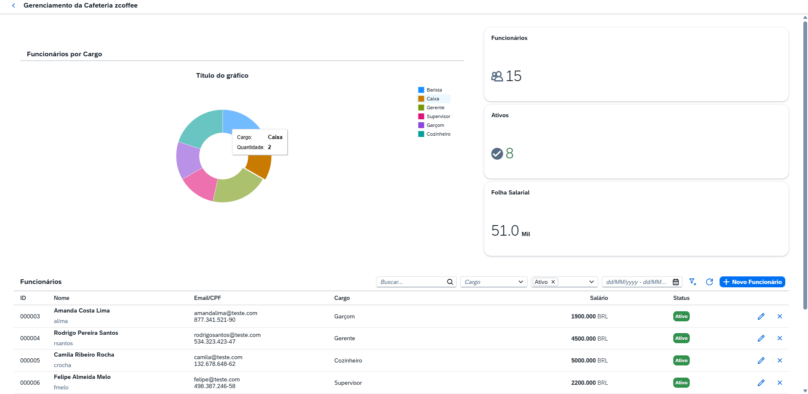
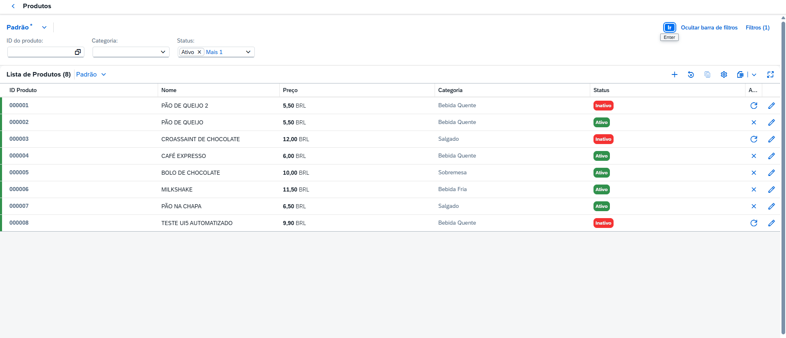
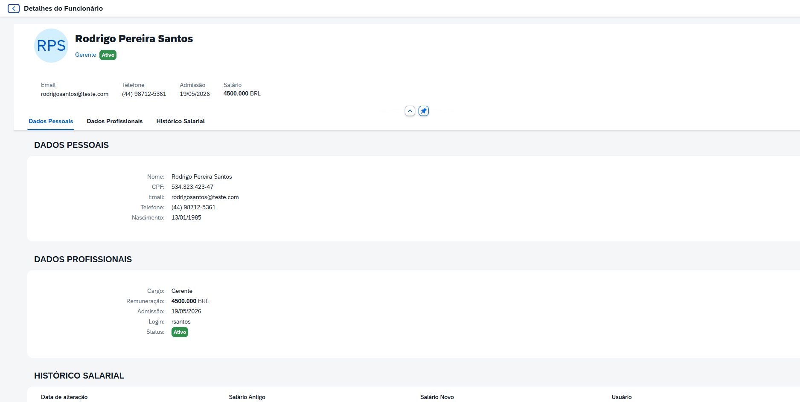

# ☕ ZCOFFEE — App Fiori (SAPUI5)

Front-end do **ZCOFFEE**, um ERP simplificado de cafeteria que eu desenvolvo como projeto de estudo no ecossistema SAP.
O app é um **SAPUI5 freestyle** que consome um serviço **OData V2** publicado no SAP Gateway e construído sobre **CDS views**.

> Back-end (ABAP / OData): [zcoffee-backend](https://github.com/cabrinileonardo/zcoffee-backend)

## Módulos

| Módulo | Telas | O que faz |
|---|---|---|
| **RH** | Lista, formulário e detalhe de funcionário | Cadastro e edição de funcionários e consulta do histórico salarial |
| **MM** | Lista e detalhe de produtos, lista de fornecedores | CRUD de produtos e fornecedores, com filtros e criação/edição em dialog |

Os módulos **SD** (pedidos) e **FI** (pagamentos) existem na versão SAP GUI do projeto e estão no roadmap do app Fiori.

## Tecnologias e conceitos usados

- SAPUI5 1.120 (tema `sap_horizon`), padrão **MVC** com **XML views**
- **OData V2** (`ZCOFFEE_SRV`) com `ODataModel`: read, create, update e remove
- **Smart controls**: `SmartTable` e `SmartFilterBar`, guiados por anotações (`ZCOFFEE_ANNO_MDL`)
- Roteamento com parâmetros (`funcionarios/{funcionarioId}`, `produtos/detail/{productId}`)
- Fragments para dialogs (`DialogProduct`, `DialogSuppliers`) e formatter próprio
- i18n, ESLint e testes com **QUnit** e **OPA5**

## Entidades OData

| EntitySet | Origem |
|---|---|
| `ZIRH_ZCOFFEE` | CDS de funcionários |
| `ZCDS_HIST_SALARIO` | CDS de histórico salarial |
| `ZI_MM_PRODUTO` | CDS de produtos |
| `ZI_MM_FORNECEDOR` | CDS de fornecedores |
| `ZI_MM_FORN_PRODUTO` | CDS de vínculo fornecedor × produto |

## Estrutura

```
webapp/
├── controller/
│   ├── MM/   ViewProducts, ViewDetailProduct, ViewSuppliers
│   └── RH/   ViewRH, ViewFormFuncionario, ViewDetailFuncionario
├── view/
│   ├── MM/ · RH/
│   └── fragments/   DialogProduct, DialogSuppliers
├── model/           formatter.js, models.js
├── localService/    metadata.xml e anotações (usados no modo mock)
└── manifest.json    rotas, data sources e modelos
```

## Como rodar

Pré-requisito: Node.js LTS.

```bash
npm install
npm run start-mock   # roda com dados simulados, sem precisar de um servidor SAP
```

Para usar um SAP real, troque `SEU-SERVIDOR-SAP:PORTA` e o mandante em `ui5.yaml` pelo seu sistema e rode `npm start`.
O serviço `ZCOFFEE_SRV` precisa estar ativo no Gateway (ver o repositório do back-end).

## Telas

| Funcionários (RH) | Produtos (MM) |
|---|---|
|  |  |



## Roadmap

- [x] Módulo RH
- [x] Módulo MM (produtos e fornecedores)
- [ ] Estoque e pedido de compra (MM)
- [ ] Pedidos de venda (SD)
- [ ] Pagamentos e faturamento (FI)

---

Projeto de estudo feito por **Leonardo Cabrini Mauro** · [LinkedIn](https://www.linkedin.com/in/leonardo-cabrini-mauro-79b292355/)
